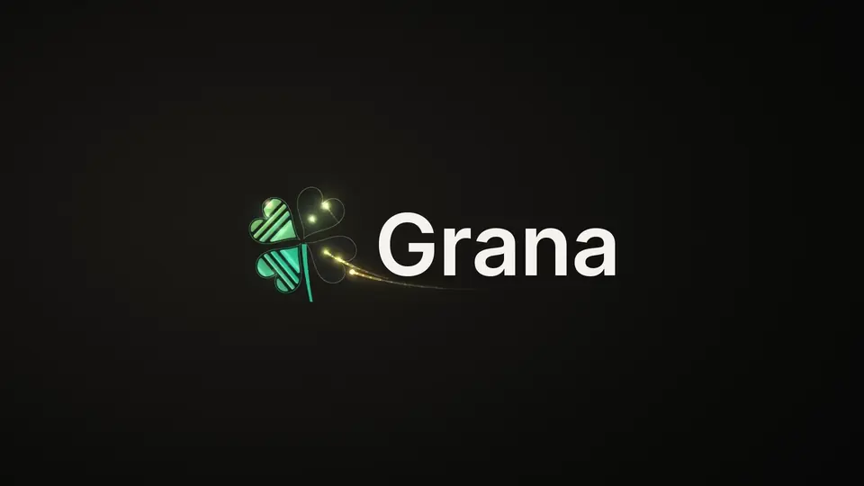

<div align="center">

# Grana

**Grana: Compositional Reward Modeling for Long-Horizon Robot Manipulation**

[](https://research.nvidia.com/labs/gear/grana/)
[](https://research.nvidia.com/labs/gear/grana/assets/paper/reward_Grana_arxiv_v1.pdf)

<a href="https://research.nvidia.com/labs/gear/grana/assets/draft/video/cover_chain_1080.mp4?v=g11"></a>

▶ [Watch the full film](https://research.nvidia.com/labs/gear/grana/assets/draft/video/cover_chain_1080.mp4?v=g11) (73 s)

</div>

Grana is a compositional reward model for long-horizon robot manipulation.
It tracks progress lost after mistakes while preserving credit for completed
steps, supporting training-time RL and test-time MPC on real robots.
The real-robot policy experiments in the paper and film use **GR00T-2** as
the policy backbone.

This repository trains and runs Qwen3.5 and Qwen3.8 reward models from **cached multi-camera RGB trajectories**:
pretrain across tasks, then adapt to a target task. Use existing Grana caches,
or build them from annotated **LeRobot v2/v3** episodes. Each model size trains
independently and loads only same-size checkpoints.

Model configurations cover Qwen3.5 0.8B, 2B, 4B, 9B and 27B, plus Qwen3.8-27B. See the
[model guide](docs/training.md#model-sizes-and-training-recipes) and
[reference results](docs/results.md).

## Install

Follow the [installation guide](docs/installation.md) for a source checkout or
release archive. It covers system prerequisites, CPU labeling, the full CUDA
runtime, GPU compatibility and checks that need no private data or task
configuration. For labeling alone, use the
[CPU setup](docs/installation.md#cpu-labeling-and-cache-construction); no GPU,
model checkpoint or API key is needed.

The full CUDA environment uses Python 3.12 and CUDA 13, with native wheels
for Linux x86_64 and aarch64.
After installing the system prerequisites and uv, run from the source root:

```bash
uv python install 3.12.3
bash scripts/setup_env.sh
source .venv-qwen35-unsloth/bin/activate
```

The installer checks the environment after setup. Runtime packages and resolved
dependencies are pinned in `requirements/`.
[Hardware guidance](docs/installation.md#hardware-and-capacity) covers backend
selection and memory planning.

Cache building needs `ffmpeg` and `ffprobe` on `PATH`; training recipes that
render MP4 evaluations need ffmpeg with libx264. Run `wandb login` for online
logging, or set `logging.mode=disabled`. The [annotation guide](docs/ANNOTATION.md#install-and-configure)
covers its optional dependencies and API setup.

## Workflow

The CPU-only environment provides `python -m grana.cli` in place of the
`grana` console command.

| Step | Command | Guide |
|---|---|---|
| Label subtasks, outcomes and action quality by hand | `grana label` | [Human labeling](docs/human-labeling.md) |
| Propose and review annotations (optional) | `python scripts/annotate_episode.py` | [Annotation](docs/ANNOTATION.md) |
| Build a cache from reviewed annotations | `grana build-cache` | [Data and target construction](docs/data.md) |
| Validate and train | `grana validate`, `bash scripts/train.sh` | [Training](docs/training.md), [phase configuration](docs/TRAINING_CONFIGS.md) |
| Score a checkpoint locally or over HTTP | `grana infer`, `python -m grana.inference.server` | [Inference](docs/inference.md) |
| Evaluate held-out trajectories | `python scripts/inference/evaluate_frames.py` | [Offline evaluation](docs/inference.md#offline-evaluation) |

Stage proposals alone are not reward supervision: cache construction also needs
explicit action-quality and outcome labels. The [annotation skill](skills/grana-robot-annotation/SKILL.md)
provides proposal methods and synthetic examples; task definitions need review.

For unannotated recordings, create a
[standalone labeling recipe](docs/project-configuration.md#labeling-your-own-recordings)
outside the source tree. Supply your own task, stages, cameras and data paths;
open the local editor, submit reviewed episodes, then build a cache with the
same active recipe. The [human-labeling guide](docs/human-labeling.md) covers
review controls. No bundled dataset or example YAML is required.

## Quick start

After installation, follow [Configure a project](docs/project-configuration.md)
to create a private training recipe and cache manifest. The guide contains
standalone schemas, so neither installation nor this workflow depends on the
repository's example task configurations. Set `GRANA_TRAIN_CONFIG` to your
recipe's absolute path and use the full CUDA environment:

```bash
: "${GRANA_TRAIN_CONFIG:?Set the absolute path to your training recipe}"
grana validate --config "$GRANA_TRAIN_CONFIG" --check-data
bash scripts/train.sh --config "$GRANA_TRAIN_CONFIG" --dry-run

# After reviewing the settings and qualifying capacity on your GPU:
bash scripts/train.sh --config "$GRANA_TRAIN_CONFIG"
```

Match `data.views` to the camera aliases in your caches and use new output
directories. Configure disjoint held-out data before quality experiments.
Choose pretraining or posttraining in your own recipe; posttraining can start
from a same-size checkpoint or the base backbone with
`training.init_checkpoint: null`. See [training](docs/training.md) for the
semantics and [inference](docs/inference.md) to score your resulting checkpoint.
Gradient checkpointing and CPU sample prefetch are enabled by default; see the
[training guide](docs/training.md) for resource tradeoffs and configuration.

## Prediction roles

Every role takes eight observations per camera plus the text shown below.
The role definitions apply to training, evaluation and inference.

| Role | Text input to the model | Source of the focus stage | Prediction |
|---|---|---|---|
| A | Whole-task description | — | Whole-task progress in [0,1] |
| B | Task, ordered stages, focus stage | Ground truth for training/evaluation; user-specified for inference | Progress relative to that focus |
| C | Task and ordered stages | — | First unfinished stage |
| D | Task, ordered stages, focus stage | C's predicted stage | Progress relative to that focus |

B and D use the same prompt format and progress head. B uses the ground-truth
stage at the POI during training and held-out evaluation, or a user-specified
stage during inference. D uses C's prediction at the selected input slot in
all three settings.

C identifies the earliest unfinished stage in task order, including failed or
incomplete prerequisites. If all stages are complete, it selects the final stage.

Primary deployment quality uses **C→D accumulated progress RMSE**, reported in
raw and normalized units. B/D focus-relative RMSE remains diagnostic; see
[evaluation semantics](docs/training.md#evaluation-and-checkpoint-semantics).

During inference, the local and HTTP client CLIs default to **POI (slot 5,
third from last)**, unless input JSON explicitly selects a frame. Direct Python
requests, the HTTP benchmark and the review browser use the same default. Use
`--prediction-frame last` to select slot 7. JSON always includes all eight slots.

Inference requires the [full CUDA runtime](docs/inference.md#runtime-requirements).
The paper's 4B BF16 inference benchmark uses **less than 10 GB** of GPU memory
at batch size 1 with eight timesteps and four camera views (32 images).
HTTP requests use lossless binary RGB; JSON is a local CLI input format.

C,D are the default outputs across the Python API, CLIs and review browser.
Explicit A or B outputs add language forwards. C runs first; D uses C's selected
stage in a separate language forward. Both share request-local image work.

## Citation

If you use Grana in your research, please cite:

```bibtex
@misc{grana2026,
  title     = {{Grana}: Compositional Reward Modeling for Long-Horizon Robot Manipulation},
  author    = {Cao, Zi-ang and Zheng, Kaiyuan and Xu, Yinzhen and
               Duan, Haonan and Gu, Jiasheng and Hu, Fengyuan and
               Zhu, Nan and Lei, Kun and Lin, Kevin and Zheng, Ruijie and
               Gao, Shenyuan and Zhu, Fangqi and Zhang, Zhe and
               Poovendran, Radha and Fan, Linxi “Jim” and Wang, Guanzhi and Zhu, Yuke},
  year      = {2026},
  url       = {https://research.nvidia.com/labs/gear/grana/}
}
```

## License and contributions

Original Grana contributions are licensed under [Apache-2.0](LICENSE),
Copyright (c) 2026 NVIDIA CORPORATION & AFFILIATES. Project attribution is in
[NOTICE](NOTICE). Third-party material retains its own terms:
[third-party notices](THIRD_PARTY_NOTICES.md) document attribution, and
[third-party licenses](THIRD_PARTY_LICENSES.md) identify the training, inference,
and annotation dependencies and their scope.
See [CONTRIBUTING.md](CONTRIBUTING.md) for contributions and
[SECURITY.md](SECURITY.md) for private vulnerability reporting.
